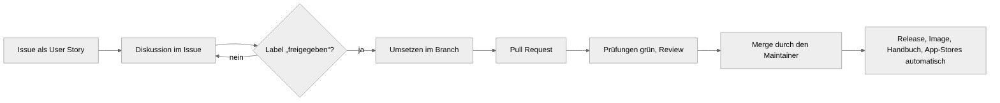

# Mitmachen bei Ablago

Schön, dass du mitmachen möchtest! Ablago ist ein kleines Projekt mit einem Maintainer ([motom001](https://github.com/motom001)). Damit Beiträge zusammenpassen und nichts umsonst gebaut wird, gilt eine einfache Arbeitsweise.

**Issues und Pull Requests sind auf Deutsch oder Englisch willkommen.** Für englischsprachige Mitwirkende gibt es [README](https://github.com/motom001/dms/blob/main/README.en.md), [CONTRIBUTING](https://github.com/motom001/dms/blob/main/CONTRIBUTING.en.md) und [SECURITY](https://github.com/motom001/dms/blob/main/SECURITY.en.md) auf Englisch; die Issue-Vorlagen sind zweisprachig.

## So läuft es

{ loading=lazy }

1. **Alles beginnt mit einem Issue**, geschrieben als User Story: *„Als … möchte ich …, damit …“* und mit Akzeptanzkriterien als Checkliste. Das gilt für Wünsche wie für Fehler. Vorlage: [Neues Issue](https://github.com/motom001/dms/issues/new/choose). Schreib dazu, **für wen** der Wunsch ist: für welche der [Personas](personas.md), von der Einsteiger-Familie bis zum Großunternehmen.
2. **Diskutiert wird im Issue**, bis klar ist, was gebaut wird und was nicht.
3. **Umgesetzt wird nur, was das Label `freigegeben` trägt.** Dieses Label vergibt allein der Maintainer. Ohne Freigabe wird ein Pull Request nicht gemergt, auch wenn er gut ist. Frag lieber im Issue nach, bevor du loslegst.
4. **Pull Request** mit `Closes #…`, Tests, angepasstem Handbuch und Release-Notizen (siehe [Beitrag einreichen](beitrag.md)).
5. **Gemergt wird nur vom Maintainer.** Danach entstehen Release, Image, Handbuch und die Einträge in den App-Stores von selbst (siehe [Release](release.md)).

!!! info "Warum das Label nur vom Maintainer kommt"
    Ablago verwaltet Verträge, Ausweise und Steuerunterlagen von Familien und kleinen Betrieben. Jede Funktion muss dauerhaft gepflegt, dokumentiert und in Sicherung und Wiederherstellung bedacht werden. Die Freigabe ist der Moment, in dem der Maintainer sagt: Das passt ins Produkt, und ich kann es langfristig tragen. Ein Workflow entfernt das Label wieder, falls es jemand anderes setzt.

!!! note "Für wen wir bauen"
    Ablago ist die Dokumentenablage für zu Hause und kleine Betriebe. Im Kern baut es für Lena, die Einsteigerin, Jonas mit dem Handy und Markus mit seinem NAS; zum Fokus gehören auch Petra, Herr Özdemir, Selbständige wie Katrin und kleine Betriebe. Steht eine Funktion im Konflikt mit Einfachheit für die ersten drei, gewinnen die drei. Mehr dazu: [Für wen wir bauen](personas.md).

## Was jeder Beitrag einhält { #was-jeder-beitrag-einhalt }

Diese Leitplanken kommen aus der Mission von Ablago und gelten für Kern, Pakete und Clients gleichermaßen:

- **Nichts verlässt das Gerät ohne ausdrückliche Zustimmung.** Jeder Weg nach draußen ist abgeschaltet, bis ein Mensch ihn auslöst oder ein Administrator ihn einschaltet – und das Handbuch sagt, was hinausgeht und wohin (siehe [Wege nach draußen](aufbau.md#wege-nach-draussen)).
- **Keine Telemetrie,** auch nicht anonym, keine Absturzberichte, nichts von fremden Servern in Oberfläche und Handbuch.
- **Offene Formate:** Was hineinkommt, muss in offenen Formaten wieder herauskommen (Vollexport, Archivfassung).
- **Updates ändern nichts heimlich:** Jede Änderung hat eine Version und Release-Notizen; Daten werden nur mit Migration und nachvollziehbar umgebaut.
- **Denkt mit, auf deinem Gerät:** Erkennen, Erinnern und Suchen laufen lokal; ein fremder Dienst nur, wenn jemand ihn ausdrücklich einrichtet.
- **Einfach zuerst:** Neues darf Lena, Jonas und Markus nicht komplizierter machen.

## Wo du helfen kannst

- **Fehler melden**, am besten mit **Werkbank → Systemzustand → Version und Updates → Übersicht für GitHub kopieren**.
- **Anleitungen prüfen und bebildern**, z. B. für [Synology, QNAP, UGREEN, TrueNAS oder Unraid](https://help.ablago.app/installieren/aktuell/), wenn du so ein Gerät hast.
- **Issues mit dem Label `good first issue`**: kleine, gut abgegrenzte Aufgaben.
- **Clients** für Hausautomatisierung, Handy oder Büro im Repository [dms-clients](https://github.com/motom001/dms-clients) – siehe [Clients entwickeln](clients.md).
- **Übersetzungen:** Oberfläche und Handbücher gibt es auf Deutsch und Englisch (#729, #730). Verbesserungen am Englischen sind willkommen; weitere Sprachen kommen als Sprachpakete ([#731](https://github.com/motom001/dms/issues/731)).

## Lizenz

Ablago steht unter der [Apache-2.0](https://github.com/motom001/dms/blob/main/LICENSE) (bis einschließlich 0.92.0: AGPL-3.0). Mit einem Beitrag stellst du ihn unter dieselbe Lizenz. Keine echten Dokumente oder persönlichen Daten committen, nur Code und Beispieldaten.
